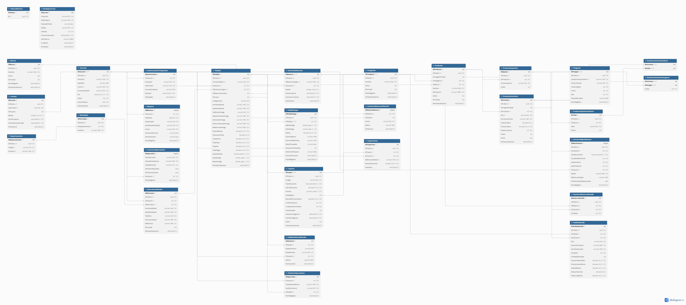

# OpenShopCart

Administrador de E-commerce esrito en [bdonald](https://github.com/BryanChavajay/). Desarrollado con TypeScript, integra tienda en linea + control administrativo.

## División del proyecto

El repositorio esta dividido escencialmente en api y frontend. Para los entornos de desarrollo navega por cada carpeta y ejecuta los pasos para levantarlos los servidores de desarrollo.

## Como levantar los ambientes de desarrollo?

### API

Desde `api/`, copia .env.example a .env para las variables de entorno, configura las conexiones a SQL server y la cache, en el ejemplo se mencionan cuales variables son opcionales y sus valores por defecto. Una vez definido el .env sigue los siguientes pasos:

1. Instala las dependencias con `pmpm install`
2. Este repositorio realiza migraciones automaticas a la base de datos, no tienes que preocuparte por reproducir las tablas de forma manual, solo ejecuta `pnpm migrate`
3. Introduce los datos semilla con `pnpm bootstrap:admin`. Sino configuraste las credenciales del primer usuario en el .env utiliza las credenciales: correo:admin@openshopcart.local y contraseña:OpenShopCart-Admin-2026!
4. Y listo, ejecuta el servidor con `pnpm dev` 🚀.
5. No olvides revisar la sección de configuraciones.

>Nota: La constraseña inicial del administrador debe tener 12 caracteres como minimo

Resumen:
```sh
cd api
pnpm install
pnpm migrate
pnpm bootstrap:admin
pnpm dev
```

>Nota: Para los secretos del JWT deben tener al menos 32 caracteres para que sean seguros. La variable `OUTBOX_ENCRYPTION_KEY` debe ser una clave de 32 bytes codificada en base64. Puedes generar una con `node -e "console.log(require('node:crypto').randomBytes(32).toString('base64'))"`

> Nota: Si no tienes instalo pnpm puedes ejecutar:
```sh
npx get-pnpm
```

`pnpm migrate` carga `.env` y ejecuta las migraciones SQL desde el código fuente. `pnpm build` compila TypeScript y `pnpm start` inicia el servidor compilado. El puerto predeterminado es 5000.

#### Configuraciones

El repositorio tiene la capacidad de enviar por correo la confirmación de la cuenta, el restablecer la contraseña y otras verificaciones. Si no quieres tenerlo habilitado asegurate tener marcado `EMAIL_SERVICE_ENABLED=true` en el .env, si quieres probarlo ponlo a `true` y genera tu clave de aplicación de Gmail en [Contraseñas de aplicaciones de Google](https://myaccount.google.com/apppasswords) (Recuerda que tiene que ser una cuenta con doble factor de autenticación)

El repositorio tambien puede aceptar pagos con tarjeta mediante stripe, si no tienes una cuenta de desarrollador para las pruebas, marca esta variable en tu .env como false 

#### Rutas disponibles

- `GET /api/v1/hello`: endpoint de ejemplo.
- RUTAS: en ./http encontraras un archivo con las rutas de la API divididas por categoria
- Junto a las rutas, encontrarás dos workflows, 90 - 91, estos te guirán para registrar un producto y sus variantes, una venta y opcionalmente cancelación de la orden.

>Nota: Si utilizas VS Code con la extensión HTTP CLIENT, podrás probar directamente las rutas sin salir del editor, si prefieres postman u otro solo guiate de los ejemplos
>Nota: Si utilizas HTTP CLIENT, este da poblemas al enviar imagenes, pero las imagenes en los productos son opcionales.

El prefijo se configura con `API_V1_STR` y por defecto es `/api/v1`.

#### Base de datos y cache

Si no tienes instalado sqlserver 22 o valkey, puedes utilizar los siguientes comandos para levantar ambos con contenedores docker:

``` sh
docker run -e "ACCEPT_EULA=Y" -e "MSSQL_SA_PASSWORD=ContraseniaSegura1234" -p 1433:1433 --name SQLSERVER22 --hostname SQLSERVER22 -d mcr.microsoft.com/mssql/server:2022-latest

docker run --name my-valkey -p 6379:6379 -d valkey/valkey:9.1.3-alpine
```

Para los datos semilla, te recomiendo seguir los workflows en http, pero si quieres en docs econtrarás un script para generar algunos productos semilla para la base.

### FRONTEND

En construcción aun, esperalo.

## Levantamiento Standalone

Si no quieres lidiar con los servidores de desarrollo y quieres probar la aplicación completa, sigue esta guía.

Encontrarás un compose.yml este es un compose de Docker para levantar BASE DE DATOS + CACHE + API + FRONTEND + BALANCEADOR DE CARGA

Si estas en desarrollo junto al compose.yml crea un .env con todas las variables necesarias para la API y FRONTEND, luego solo ejecuta:

``` text
Esperalo, el frontend sigue en construcción
```

## Arquitectura y migraciones

### API

En la API utilizamos una arquitectura limpia + DDD, pero, ¿Esto que quiere decir? En terminos sencillos, las reglas de negocio permanecen agnosticas a los detalles de implementación, esto permite que las reglas de negocio no dependan de librerias o frameworks que facilmente pueden ser sustituidos mañana. 

Pero, ¿Qué es una regla de negocio?, son las reglas especiales que definen al negocio, por ejemplo que un cliente no pueda ver el pedido de alquien más, que un correo no pueda estar duplicado, que un usuario administrador no se pueda eliminar a sí mismo, etc.

#### ¿Como se traduce esto a la API?

Principalmente tenemos las siguientes capas:

1. `application`: Casos de uso, orquestadores de las entidades, interfaces, resultados, etc.
2. `domain`: Nucleo de la aplicación, donde estan la mayoria de reglas de negocio, donde se encuentran las entidades que dan vida a la aplicación, interfaces, modelos de lectura, etc.
3. `infraestructure`: Implementaciones de las interfaces, aca viven las librerias, estas implementan los contratos inquebrantables de las interfaces, por lo cual se convierten en piezas intercambiables.
4. `presentation`: Capa donde se presenta nuestra aplicación con el exterior.

Como puedes darte cuenta, el dominio y los casos de uso unicamente utilizan la librería estandar del lenguaje (en nuestro caso TS), esto es muy conveniente ya que las reglas de negocio tienen esa estabilidad de no romperse si mañana decidimos cambiar de cache o cambiar de almacen de objetos local a S3 de amazon, etc.

Puede que te preguntes ¿Qué es una interfaz?, en la practica, piensa en ello como un contrato que no se puede romper.

Quiza te pregunte de igual manera, si dominio y los casos de uso no conocen librerias y solo interfaces, como se comunican con una base de datos, con la cache, con el framework, etc. Separemoslo por pasos:

1. Infraestructura, esta implementa las interfaces que dominio expone, esto obliga a cada implementación a respetar los metodos, parametros y resultados que las reglas de negocio exigen.
2. En la presentación, tomamos los casos de uso y les inyectamos las implementaciones de infraestructura, de manera que ya pueden comunicarse con el exterior.

Piensa en la siguiente analogia, tu construyes los planos de un horno, que botones debe tener, como se regula la temperatura, etc. Cada fabricante de hornos lee tus planos y arma su propia versión pero siempre respetando tus planos, así no importa si te traen un horno samsung o LG o cualquier otro, sabras como utilizarlos de inmediato ya que nosoros definimos los elementos que deben tener.

#### Base de datos:

A continuación adjunto el diagrama de entidad relación:


Si prefieros verlo en mermaind, puedes dirigirte a:
[Mermaind](./docs/database-schema.md)
