# Esquema de Base de Datos — OpenShopCart

> Fuente: migraciones `.do.` de `api/src/infrastructure/migrations` (SQL Server / T-SQL).

## Índice de tablas (30)

| #   | Tabla                       | Migración |
| --- | --------------------------- | --------- |
| 1   | Usuarios                    | 001       |
| 2   | AutorizacionesTemporales    | 001       |
| 3   | TokensRefresco              | 001       |
| 4   | BandejaCorreos              | 001       |
| 5   | Bitacora                    | 003       |
| 6   | Categorias                  | 004       |
| 7   | Marcas                      | 004       |
| 8   | Imagenes                    | 004       |
| 9   | Productos                   | 004       |
| 10  | ProductosVariantes          | 004       |
| 11  | ProductosOpciones           | 004       |
| 12  | ProductosOpcionesValores    | 004       |
| 13  | ProductosVariantesValores   | 004       |
| 14  | ProductosVariantesImagenes  | 004       |
| 15  | InventarioMovimientos       | 005       |
| 16  | InventarioReservas          | 005       |
| 17  | InventarioReservasDetalle   | 005       |
| 18  | InventarioReservasHistorial | 005       |
| 19  | InventarioOperaciones       | 005       |
| 20  | Carritos                    | 007       |
| 21  | Cupones                     | 008       |
| 22  | CuponesUsos                 | 008       |
| 23  | Departamentos               | 009       |
| 24  | Municipios                  | 009       |
| 25  | DireccionesClientes         | 009       |
| 26  | Pedidos                     | 010       |
| 27  | PedidosDetalle              | 010       |
| 28  | PedidosPagos                | 010       |
| 29  | PedidosHistorialEstados     | 010       |
| 30  | CheckoutOperaciones         | 010       |

---

## Migración 001 — create-tables (identidad y seguridad)

### dbo.Usuarios
| Columna        | Tipo             | Null     | Default/Extra            | Constraints                    |
| -------------- | ---------------- | -------- | ------------------------ | ------------------------------ |
| IDUsuario      | INT              | NOT NULL | IDENTITY(1,1)            | PK_Usuarios (PRIMARY KEY)      |
| IDPublico      | UNIQUEIDENTIFIER | NOT NULL |                          | UQ_Usuarios_IDPublico (UNIQUE) |
| Nombres        | NVARCHAR(100)    | NOT NULL |                          |                                |
| Apellidos      | NVARCHAR(100)    | NULL     |                          |                                |
| Correo         | NVARCHAR(254)    | NOT NULL |                          | UQ_Usuarios_Correo (UNIQUE)    |
| ContrasenaHash | NVARCHAR(255)    | NOT NULL |                          |                                |
| Rol            | NVARCHAR(20)     | NOT NULL |                          |                                |
| Activo         | BIT              | NOT NULL |                          |                                |
| Eliminado      | BIT              | NOT NULL |                          |                                |
| VersionSesion  | UNIQUEIDENTIFIER | NOT NULL |                          |                                |
| FechaCreacion  | DATETIME2(3)     | NOT NULL | DEFAULT SYSUTCDATETIME() |                                |

- PK: IDUsuario
- FKs: - Ninguna
- UNIQUE: IDPublico; Correo
- CHECK: CK_Usuarios_Rol — Rol IN ('CLIENTE', 'OPERADOR', 'ADMINISTRADOR')

### dbo.AutorizacionesTemporales
| Columna         | Tipo          | Null     | Default/Extra | Constraints                               |
| --------------- | ------------- | -------- | ------------- | ----------------------------------------- |
| IDAutorizacion  | INT           | NOT NULL | IDENTITY(1,1) | PK_AutorizacionesTemporales (PRIMARY KEY) |
| IDUsuario       | INT           | NOT NULL |               | FK_AutorizacionesTemporales_Usuarios      |
| Proposito       | NVARCHAR(50)  | NOT NULL |               |                                           |
| HashToken       | NVARCHAR(128) | NOT NULL |               |                                           |
| CorreoPendiente | NVARCHAR(254) | NULL     |               |                                           |
| ExpiraEn        | DATETIME2(3)  | NOT NULL |               |                                           |
| UtilizadaEn     | DATETIME2(3)  | NULL     |               |                                           |

- PK: IDAutorizacion
- FKs: FK_AutorizacionesTemporales_Usuarios → dbo.Usuarios(IDUsuario)
- UNIQUE: - Ninguna
- CHECK: CK_AutorizacionesTemporales_Proposito — Proposito IN ('ACCOUNT_CONFIRMATION', 'PASSWORD_RECOVERY', 'EMAIL_CHANGE'); CK_AutorizacionesTemporales_CorreoPendiente — CorreoPendiente IS NULL OR Proposito = 'EMAIL_CHANGE'
- Índices: IX_AutorizacionesTemporales_HashToken ON (Proposito, HashToken) INCLUDE (IDAutorizacion, IDUsuario, CorreoPendiente, ExpiraEn) WHERE UtilizadaEn IS NULL; IX_AutorizacionesTemporales_Pendientes ON (IDUsuario, Proposito) WHERE UtilizadaEn IS NULL

### dbo.TokensRefresco
| Columna | Tipo             | Null     | Default/Extra | Constraints                     |
| ------- | ---------------- | -------- | ------------- | ------------------------------- |
| IDToken | INT              | NOT NULL | IDENTITY(1,1) | PK_TokensRefresco (PRIMARY KEY) |
| Jti     | UNIQUEIDENTIFIER | NOT NULL |               | UQ_TokensRefresco_Jti (UNIQUE)  |

- PK: IDToken
- FKs: - Ninguna
- UNIQUE: Jti

### dbo.BandejaCorreos
| Columna          | Tipo           | Null     | Default/Extra            | Constraints                     |
| ---------------- | -------------- | -------- | ------------------------ | ------------------------------- |
| IDCorreo         | INT            | NOT NULL | IDENTITY(1,1)            | PK_BandejaCorreos (PRIMARY KEY) |
| Proposito        | NVARCHAR(50)   | NOT NULL |                          |                                 |
| Destinatario     | NVARCHAR(254)  | NOT NULL |                          |                                 |
| PayloadCifrado   | NVARCHAR(MAX)  | NULL     |                          |                                 |
| Estado           | NVARCHAR(20)   | NOT NULL |                          |                                 |
| Intentos         | INT            | NOT NULL | DEFAULT 0                |                                 |
| ProximoIntentoEn | DATETIME2(3)   | NOT NULL |                          |                                 |
| UltimoError      | NVARCHAR(2000) | NULL     |                          |                                 |
| CreadoEn         | DATETIME2(3)   | NOT NULL | DEFAULT SYSUTCDATETIME() |                                 |
| EnviadoEn        | DATETIME2(3)   | NULL     |                          |                                 |

- PK: IDCorreo
- FKs: - Ninguna
- CHECK: CK_BandejaCorreos_Proposito — Proposito IN ('ACCOUNT_CONFIRMATION', 'PASSWORD_RECOVERY', 'EMAIL_CHANGE'); CK_BandejaCorreos_Estado — Estado IN ('PENDIENTE', 'ENVIADO'); CK_BandejaCorreos_Intentos — Intentos >= 0
- Índices: IX_BandejaCorreos_Estado_ProximoIntentoEn ON (Estado, ProximoIntentoEn)

---

## Migración 003 — create-audit (bitácora)

### dbo.Bitacora
| Columna              | Tipo          | Null     | Default/Extra            | Constraints               |
| -------------------- | ------------- | -------- | ------------------------ | ------------------------- |
| IDBitacora           | BIGINT        | NOT NULL | IDENTITY(1,1)            | PK_Bitacora (PRIMARY KEY) |
| IDUsuario            | INT           | NOT NULL |                          | FK_Bitacora_Usuarios      |
| IDModulo             | SMALLINT      | NOT NULL |                          | CK_Bitacora_Modulo        |
| TipoEntidad          | NVARCHAR(50)  | NOT NULL |                          |                           |
| IdentificadorEntidad | NVARCHAR(50)  | NOT NULL |                          |                           |
| Accion               | NVARCHAR(20)  | NOT NULL |                          | CK_Bitacora_Accion        |
| ValoresAnteriores    | NVARCHAR(MAX) | NULL     |                          |                           |
| ValoresNuevos        | NVARCHAR(MAX) | NULL     |                          |                           |
| FechaRegistro        | DATETIME2(3)  | NOT NULL | DEFAULT SYSUTCDATETIME() |                           |

- PK: IDBitacora
- FKs: FK_Bitacora_Usuarios → dbo.Usuarios(IDUsuario)
- CHECK: CK_Bitacora_Modulo — IDModulo IN (10, 20, 30, 40); CK_Bitacora_Accion — Accion IN ('CREATE', 'UPDATE', 'DEACTIVATE', 'DELETE')
- Índices: IX_Bitacora_Modulo_FechaRegistro ON (IDModulo, FechaRegistro DESC, IDBitacora DESC)

---

## Migración 004 — create-catalog (catálogo de productos)

### dbo.Categorias
| Columna            | Tipo             | Null     | Default/Extra            | Constraints                      |
| ------------------ | ---------------- | -------- | ------------------------ | -------------------------------- |
| IDCategoria        | INT              | NOT NULL | IDENTITY(1,1)            | PK_Categorias (PRIMARY KEY)      |
| IDPublico          | UNIQUEIDENTIFIER | NOT NULL |                          | UQ_Categorias_IDPublico (UNIQUE) |
| Nombre             | NVARCHAR(100)    | NOT NULL |                          |                                  |
| Activo             | BIT              | NOT NULL | DEFAULT 1                |                                  |
| Eliminado          | BIT              | NOT NULL | DEFAULT 0                |                                  |
| FechaRegistro      | DATETIME2(3)     | NOT NULL | DEFAULT SYSUTCDATETIME() |                                  |
| FechaActualizacion | DATETIME2(3)     | NOT NULL | DEFAULT SYSUTCDATETIME() |                                  |

- PK: IDCategoria
- FKs: - Ninguna
- Índices: UX_Categorias_Nombre ON (Nombre) WHERE Eliminado = 0 (único filtrado); IX_Categorias_Activo_Eliminado ON (Activo, Eliminado)

### dbo.Marcas
| Columna            | Tipo             | Null     | Default/Extra            | Constraints                  |
| ------------------ | ---------------- | -------- | ------------------------ | ---------------------------- |
| IDMarca            | INT              | NOT NULL | IDENTITY(1,1)            | PK_Marcas (PRIMARY KEY)      |
| IDPublico          | UNIQUEIDENTIFIER | NOT NULL |                          | UQ_Marcas_IDPublico (UNIQUE) |
| Nombre             | NVARCHAR(100)    | NOT NULL |                          |                              |
| Activo             | BIT              | NOT NULL | DEFAULT 1                |                              |
| Eliminado          | BIT              | NOT NULL | DEFAULT 0                |                              |
| FechaRegistro      | DATETIME2(3)     | NOT NULL | DEFAULT SYSUTCDATETIME() |                              |
| FechaActualizacion | DATETIME2(3)     | NOT NULL | DEFAULT SYSUTCDATETIME() |                              |

- PK: IDMarca
- FKs: - Ninguna
- Índices: UX_Marcas_Nombre ON (Nombre) WHERE Eliminado = 0 (único filtrado); IX_Marcas_Activo_Eliminado ON (Activo, Eliminado)

### dbo.Imagenes
| Columna             | Tipo             | Null     | Default/Extra            | Constraints                              |
| ------------------- | ---------------- | -------- | ------------------------ | ---------------------------------------- |
| IDImagen            | INT              | NOT NULL | IDENTITY(1,1)            | PK_Imagenes (PRIMARY KEY)                |
| IDPublico           | UNIQUEIDENTIFIER | NOT NULL |                          | UQ_Imagenes_IDPublico (UNIQUE)           |
| ClaveAlmacenamiento | NVARCHAR(100)    | NOT NULL |                          | UQ_Imagenes_ClaveAlmacenamiento (UNIQUE) |
| TipoContenido       | NVARCHAR(50)     | NOT NULL |                          |                                          |
| TamanoBytes         | INT              | NOT NULL |                          | CK_Imagenes_Archivo                      |
| Ancho               | INT              | NOT NULL |                          | CK_Imagenes_Archivo                      |
| Alto                | INT              | NOT NULL |                          | CK_Imagenes_Archivo                      |
| TextoAlternativo    | NVARCHAR(300)    | NULL     |                          |                                          |
| FechaRegistro       | DATETIME2(3)     | NOT NULL | DEFAULT SYSUTCDATETIME() |                                          |

- PK: IDImagen
- FKs: - Ninguna
- CHECK: CK_Imagenes_Archivo — TamanoBytes > 0 AND Ancho > 0 AND Alto > 0

### dbo.Productos
| Columna            | Tipo             | Null     | Default/Extra            | Constraints                     |
| ------------------ | ---------------- | -------- | ------------------------ | ------------------------------- |
| IDProducto         | INT              | NOT NULL | IDENTITY(1,1)            | PK_Productos (PRIMARY KEY)      |
| IDImagenPortada    | INT              | NULL     |                          | FK_Productos_ImagenPortada      |
| IDPublico          | UNIQUEIDENTIFIER | NOT NULL |                          | UQ_Productos_IDPublico (UNIQUE) |
| IDCategoria        | INT              | NOT NULL |                          | FK_Productos_Categorias         |
| IDMarca            | INT              | NOT NULL |                          | FK_Productos_Marcas             |
| Nombre             | NVARCHAR(200)    | NOT NULL |                          |                                 |
| Descripcion        | NVARCHAR(2000)   | NOT NULL |                          |                                 |
| Activo             | BIT              | NOT NULL | DEFAULT 0                |                                 |
| Eliminado          | BIT              | NOT NULL | DEFAULT 0                |                                 |
| FechaRegistro      | DATETIME2(3)     | NOT NULL | DEFAULT SYSUTCDATETIME() |                                 |
| FechaActualizacion | DATETIME2(3)     | NOT NULL | DEFAULT SYSUTCDATETIME() |                                 |

- PK: IDProducto
- FKs: FK_Productos_ImagenPortada → dbo.Imagenes(IDImagen); FK_Productos_Categorias → dbo.Categorias(IDCategoria); FK_Productos_Marcas → dbo.Marcas(IDMarca)
- Índices: IX_Productos_IDCategoria, IX_Productos_IDMarca, IX_Productos_IDImagenPortada, IX_Productos_Activo_Eliminado, IX_Productos_Nombre

### dbo.ProductosVariantes
| Columna            | Tipo             | Null     | Default/Extra            | Constraints                                                        |
| ------------------ | ---------------- | -------- | ------------------------ | ------------------------------------------------------------------ |
| IDVariante         | INT              | NOT NULL | IDENTITY(1,1)            | PK_ProductosVariantes (PRIMARY KEY)                                |
| IDPublico          | UNIQUEIDENTIFIER | NOT NULL |                          | UQ_ProductosVariantes_IDPublico (UNIQUE)                           |
| IDImagenPortada    | INT              | NULL     |                          | FK_ProductosVariantes_ImagenPortada                                |
| IDProducto         | INT              | NOT NULL |                          | FK_ProductosVariantes_Productos (ON DELETE CASCADE)                |
| SKU                | NVARCHAR(64)     | NOT NULL |                          | UQ_ProductosVariantes_SKU (UNIQUE)                                 |
| NombreVariante     | NVARCHAR(100)    | NOT NULL |                          |                                                                    |
| CostoUnitario      | DECIMAL(10,2)    | NULL     |                          | CK_ProductosVariantes_CostoUnitario                                |
| PrecioUnitario     | DECIMAL(10,2)    | NOT NULL |                          | CK_ProductosVariantes_PrecioUnitario                               |
| ExistenciaFisica   | INT              | NOT NULL | DEFAULT 0                | CK_ProductosVariantes_ExistenciaFisicaNoNegativa (agregada en 005) |
| Orden              | INT              | NOT NULL | DEFAULT 1                |                                                                    |
| Activo             | BIT              | NOT NULL | DEFAULT 1                |                                                                    |
| Eliminado          | BIT              | NOT NULL | DEFAULT 0                |                                                                    |
| FechaRegistro      | DATETIME2(3)     | NOT NULL | DEFAULT SYSUTCDATETIME() |                                                                    |
| FechaActualizacion | DATETIME2(3)     | NOT NULL | DEFAULT SYSUTCDATETIME() |                                                                    |

- PK: IDVariante
- FKs: FK_ProductosVariantes_ImagenPortada → dbo.Imagenes(IDImagen); FK_ProductosVariantes_Productos → dbo.Productos(IDProducto) ON DELETE CASCADE
- CHECK: CK_ProductosVariantes_PrecioUnitario — PrecioUnitario > 0; CK_ProductosVariantes_CostoUnitario — CostoUnitario IS NULL OR CostoUnitario >= 0
- Índices: IX_ProductosVariantes_IDProducto, IX_ProductosVariantes_IDImagenPortada, IX_ProductosVariantes_PrecioUnitario

### dbo.ProductosOpciones
| Columna      | Tipo             | Null     | Default/Extra | Constraints                                        |
| ------------ | ---------------- | -------- | ------------- | -------------------------------------------------- |
| IDOpcion     | INT              | NOT NULL | IDENTITY(1,1) | PK_ProductosOpciones (PRIMARY KEY)                 |
| IDPublico    | UNIQUEIDENTIFIER | NOT NULL |               | UQ_ProductosOpciones_IDPublico (UNIQUE)            |
| IDProducto   | INT              | NOT NULL |               | FK_ProductosOpciones_Productos (ON DELETE CASCADE) |
| NombreOpcion | NVARCHAR(50)     | NOT NULL |               | UQ_ProductosOpciones_Producto_NombreOpcion         |
| Orden        | INT              | NOT NULL | DEFAULT 1     | UQ_ProductosOpciones_Producto_Orden                |

- PK: IDOpcion
- FKs: FK_ProductosOpciones_Productos → dbo.Productos(IDProducto) ON DELETE CASCADE
- UNIQUE: (IDProducto, NombreOpcion); (IDProducto, Orden)

### dbo.ProductosOpcionesValores
| Columna   | Tipo             | Null     | Default/Extra | Constraints                                                       |
| --------- | ---------------- | -------- | ------------- | ----------------------------------------------------------------- |
| IDValor   | INT              | NOT NULL | IDENTITY(1,1) | PK_ProductosOpcionesValores (PRIMARY KEY)                         |
| IDPublico | UNIQUEIDENTIFIER | NOT NULL |               | UQ_ProductosOpcionesValores_IDPublico (UNIQUE)                    |
| IDOpcion  | INT              | NOT NULL |               | FK_ProductosOpcionesValores_ProductosOpciones (ON DELETE CASCADE) |
| Valor     | NVARCHAR(50)     | NOT NULL |               | UQ_ProductosOpcionesValores_Opcion_Valor                          |
| Orden     | INT              | NOT NULL | DEFAULT 1     | UQ_ProductosOpcionesValores_Opcion_Orden                          |

- PK: IDValor
- FKs: FK_ProductosOpcionesValores_ProductosOpciones → dbo.ProductosOpciones(IDOpcion) ON DELETE CASCADE
- UNIQUE: (IDOpcion, Valor); (IDOpcion, Orden)

### dbo.ProductosVariantesValores
| Columna    | Tipo | Null     | Default/Extra | Constraints                       |
| ---------- | ---- | -------- | ------------- | --------------------------------- |
| IDVariante | INT  | NOT NULL |               | PK_ProductosVariantesValores + FK |
| IDValor    | INT  | NOT NULL |               | PK_ProductosVariantesValores + FK |

- PK: compuesta (IDVariante, IDValor)
- FKs: FK_ProductosVariantesValores_ProductosVariantes → dbo.ProductosVariantes(IDVariante) ON DELETE CASCADE; FK_ProductosVariantesValores_ProductosOpcionesValores → dbo.ProductosOpcionesValores(IDValor) (sin CASCADE, para evitar múltiples rutas de cascada)
- Índices: IX_ProductosVariantesValores_IDValor ON (IDValor)

### dbo.ProductosVariantesImagenes
| Columna    | Tipo | Null     | Default/Extra | Constraints                                                              |
| ---------- | ---- | -------- | ------------- | ------------------------------------------------------------------------ |
| IDVariante | INT  | NOT NULL |               | PK + FK                                                                  |
| IDImagen   | INT  | NOT NULL |               | PK + FK                                                                  |
| Orden      | INT  | NOT NULL |               | UQ_ProductosVariantesImagenes_Orden; CK_ProductosVariantesImagenes_Orden |

- PK: compuesta (IDVariante, IDImagen)
- FKs: FK_ProductosVariantesImagenes_Variante → dbo.ProductosVariantes(IDVariante) ON DELETE CASCADE; FK_ProductosVariantesImagenes_Imagen → dbo.Imagenes(IDImagen)
- UNIQUE: (IDVariante, Orden); CHECK: Orden >= 1
- Índices: IX_ProductosVariantesImagenes_IDImagen ON (IDImagen)

---

## Migración 005 — create-inventory (inventario / kardex)

> Además de sus tablas, ejecuta `ALTER TABLE dbo.ProductosVariantes ADD CONSTRAINT CK_ProductosVariantes_ExistenciaFisicaNoNegativa CHECK (ExistenciaFisica >= 0)`.

### dbo.InventarioMovimientos
| Columna                   | Tipo             | Null     | Default/Extra            | Constraints                                                     |
| ------------------------- | ---------------- | -------- | ------------------------ | --------------------------------------------------------------- |
| IDMovimiento              | BIGINT           | NOT NULL | IDENTITY(1,1)            | PK_InventarioMovimientos (PRIMARY KEY)                          |
| IDPublico                 | UNIQUEIDENTIFIER | NOT NULL |                          | UQ_InventarioMovimientos_IDPublico (UNIQUE)                     |
| IDVariante                | INT              | NOT NULL |                          | FK_InventarioMovimientos_ProductosVariantes                     |
| TipoMovimiento            | NVARCHAR(30)     | NOT NULL |                          | CK_InventarioMvt_Tipo; CK_InventarioMovimientos_TipoDiferencial |
| CantidadDiferencial       | INT              | NOT NULL |                          | CK_InventarioMovimientos_Diferencial                            |
| SaldoAnterior             | INT              | NOT NULL |                          | CK_InventarioMovimientos_SaldoAnterior                          |
| SaldoPosterior            | INT              | NOT NULL |                          | CK_InventarioMovimientos_SaldoPosterior                         |
| IDUsuario                 | INT              | NOT NULL |                          | FK_InventarioMovimientos_Usuarios                               |
| Motivo                    | NVARCHAR(200)    | NOT NULL |                          |                                                                 |
| ReferenciaOrigen          | NVARCHAR(100)    | NULL     |                          |                                                                 |
| IDPublicoVentaRelacionada | UNIQUEIDENTIFIER | NULL     |                          | CK_InventarioMovimientos_VentaRelacionada                       |
| FechaRegistro             | DATETIME2(3)     | NOT NULL | DEFAULT SYSUTCDATETIME() |                                                                 |

- PK: IDMovimiento
- FKs: FK_InventarioMovimientos_ProductosVariantes → dbo.ProductosVariantes(IDVariante); FK_InventarioMovimientos_Usuarios → dbo.Usuarios(IDUsuario)
- CHECK: TipoMovimiento IN ('PURCHASE_RECEIPT', 'SALE', 'MANUAL_ADJUSTMENT', 'CUSTOMER_RETURN', 'SALE_CANCELLATION'); CantidadDiferencial <> 0; SaldoAnterior >= 0; SaldoPosterior >= 0; IDPublicoVentaRelacionada solo para SALE/SALE_CANCELLATION/CUSTOMER_RETURN; regla de signo por tipo de movimiento
- Índices: IX_InventarioMovimientos_IDVariante ON (IDVariante, FechaRegistro DESC, IDMovimiento DESC); IX_InventarioMovimientos_VentaRelacionada (filtrado WHERE IDPublicoVentaRelacionada IS NOT NULL); IX_InventarioMovimientos_IDUsuario

### dbo.InventarioReservas
| Columna          | Tipo             | Null     | Default/Extra            | Constraints                                    |
| ---------------- | ---------------- | -------- | ------------------------ | ---------------------------------------------- |
| IDReserva        | INT              | NOT NULL | IDENTITY(1,1)            | PK_InventarioReservas (PRIMARY KEY)            |
| IDPublico        | UNIQUEIDENTIFIER | NOT NULL |                          | UQ_InventarioReservas_IDPublico (UNIQUE)       |
| ReferenciaOrigen | NVARCHAR(100)    | NOT NULL |                          | UX_InventarioReservas_ReferenciaOrigen (único) |
| IDUsuario        | INT              | NOT NULL |                          | FK_InventarioReservas_Usuarios                 |
| Estado           | NVARCHAR(20)     | NOT NULL | DEFAULT 'ACTIVE'         | CK_InventarioReservas_Estado                   |
| FechaCreacion    | DATETIME2(3)     | NOT NULL | DEFAULT SYSUTCDATETIME() | CK_InventarioReservas_Fechas                   |
| FechaVencimiento | DATETIME2(3)     | NOT NULL |                          |                                                |
| FechaCierre      | DATETIME2(3)     | NULL     |                          |                                                |

- PK: IDReserva
- FKs: FK_InventarioReservas_Usuarios → dbo.Usuarios(IDUsuario)
- CHECK: Estado IN ('ACTIVE', 'CONSUMED', 'RELEASED', 'EXPIRED'); FechaVencimiento > FechaCreacion
- Índices: UX_InventarioReservas_ReferenciaOrigen UNIQUE; IX_InventarioReservas_Estado_FechaVencimiento

### dbo.InventarioReservasDetalle
| Columna          | Tipo             | Null     | Default/Extra | Constraints                                                             |
| ---------------- | ---------------- | -------- | ------------- | ----------------------------------------------------------------------- |
| IDReservaDetalle | INT              | NOT NULL | IDENTITY(1,1) | PK_InventarioReservasDetalle (PRIMARY KEY)                              |
| IDPublico        | UNIQUEIDENTIFIER | NOT NULL |               | UQ_InventarioReservasDetalle_IDPublico (UNIQUE)                         |
| IDReserva        | INT              | NOT NULL |               | FK_InventarioReservasDetalle_InventarioReservas (CASCADE); UQ compuesto |
| IDVariante       | INT              | NOT NULL |               | FK_InventarioReservasDetalle_ProductosVariantes; UQ compuesto           |
| Cantidad         | INT              | NOT NULL |               | CK_InventarioReservasDetalle_Cantidad                                   |

- PK: IDReservaDetalle
- FKs: FK_InventarioReservasDetalle_InventarioReservas → dbo.InventarioReservas(IDReserva) ON DELETE CASCADE; FK_InventarioReservasDetalle_ProductosVariantes → dbo.ProductosVariantes(IDVariante)
- UNIQUE: (IDReserva, IDVariante); CHECK: Cantidad > 0
- Índices: IX_InventarioReservasDetalle_IDVariante

### dbo.InventarioReservasHistorial
| Columna           | Tipo          | Null     | Default/Extra            | Constraints                                       |
| ----------------- | ------------- | -------- | ------------------------ | ------------------------------------------------- |
| IDHistoriaReserva | BIGINT        | NOT NULL | IDENTITY(1,1)            | PK_InventarioReservasHistorial (PRIMARY KEY)      |
| IDReserva         | INT           | NOT NULL |                          | FK_InventarioReservasHistorial_InventarioReservas |
| IDUsuario         | INT           | NULL     |                          | FK_InventarioReservasHistorial_Usuarios           |
| Accion            | NVARCHAR(20)  | NOT NULL |                          | CK_InventarioReservasHistorial_Accion             |
| Motivo            | NVARCHAR(200) | NULL     |                          | CK_InventarioReservasHistorial_Motivo             |
| FechaHora         | DATETIME2(3)  | NOT NULL | DEFAULT SYSUTCDATETIME() |                                                   |

- PK: IDHistoriaReserva
- FKs: FK_InventarioReservasHistorial_InventarioReservas → dbo.InventarioReservas(IDReserva); FK_InventarioReservasHistorial_Usuarios → dbo.Usuarios(IDUsuario)
- CHECK: Accion IN ('CREATED', 'RELEASED', 'CONSUMED', 'EXPIRED'); EXPIRED no admite IDUsuario/Motivo, acciones humanas los exigen
- Índices: IX_InventarioReservasHistorial_IDReserva ON (IDReserva)

### dbo.InventarioOperaciones
| Columna            | Tipo             | Null     | Default/Extra            | Constraints                            |
| ------------------ | ---------------- | -------- | ------------------------ | -------------------------------------- |
| IDOperacion        | BIGINT           | NOT NULL | IDENTITY(1,1)            | PK_InventarioOperaciones (PRIMARY KEY) |
| TipoOperacion      | NVARCHAR(40)     | NOT NULL |                          | UQ_InventarioOperaciones (compuesto)   |
| ClaveIdempotencia  | NVARCHAR(100)    | NOT NULL |                          | UQ_InventarioOperaciones (compuesto)   |
| HuellaSolicitud    | NVARCHAR(512)    | NOT NULL |                          |                                        |
| IDPublicoResultado | UNIQUEIDENTIFIER | NULL     |                          |                                        |
| IDPublicoVariante  | UNIQUEIDENTIFIER | NULL     |                          |                                        |
| IDUsuario          | INT              | NOT NULL |                          | FK_InventarioOperaciones_Usuarios      |
| FechaRegistro      | DATETIME2(3)     | NOT NULL | DEFAULT SYSUTCDATETIME() |                                        |

- PK: IDOperacion
- FKs: FK_InventarioOperaciones_Usuarios → dbo.Usuarios(IDUsuario)
- UNIQUE: (TipoOperacion, ClaveIdempotencia)
- Índices: IX_InventarioOperaciones_IDUsuario

---

## Migración 007 — create-cart (carrito)

### dbo.Carritos
| Columna              | Tipo             | Null     | Default/Extra            | Constraints                    |
| -------------------- | ---------------- | -------- | ------------------------ | ------------------------------ |
| IDCarrito            | INT              | NOT NULL | IDENTITY(1,1)            | PK_Carritos (PRIMARY KEY)      |
| IDPublico            | UNIQUEIDENTIFIER | NOT NULL |                          | UQ_Carritos_IDPublico (UNIQUE) |
| HashToken            | CHAR(64)         | NOT NULL |                          | UQ_Carritos_HashToken (UNIQUE) |
| IDUsuario            | INT              | NULL     |                          | FK_Carritos_Usuarios           |
| Estado               | NVARCHAR(20)     | NOT NULL | DEFAULT 'ACTIVE'         | CK_Carritos_Estado             |
| FechaCreacion        | DATETIME2(3)     | NOT NULL | DEFAULT SYSUTCDATETIME() | CK_Carritos_Fechas             |
| FechaUltimaActividad | DATETIME2(3)     | NOT NULL | DEFAULT SYSUTCDATETIME() |                                |
| FechaCierre          | DATETIME2(3)     | NULL     |                          | CK_Carritos_CierreEnActiva     |

- PK: IDCarrito
- FKs: FK_Carritos_Usuarios → dbo.Usuarios(IDUsuario)
- CHECK: Estado IN ('ACTIVE', 'EMPTIED', 'CONVERTED'); FechaUltimaActividad >= FechaCreacion; (Estado='ACTIVE' AND FechaCierre IS NULL) OR (Estado IN ('EMPTIED','CONVERTED') AND FechaCierre IS NOT NULL)
- Índices: IX_Carritos_Estado_FechaUltimaActividad

---

## Migración 008 — create-coupons (cupones)

### dbo.Cupones
| Columna              | Tipo             | Null     | Default/Extra            | Constraints                     |
| -------------------- | ---------------- | -------- | ------------------------ | ------------------------------- |
| IDCupon              | INT              | NOT NULL | IDENTITY(1,1)            | PK_Cupones (PRIMARY KEY)        |
| IDPublico            | UNIQUEIDENTIFIER | NOT NULL |                          | UQ_Cupones_IDPublico (UNIQUE)   |
| Codigo               | NVARCHAR(64)     | NOT NULL |                          | Único filtrado                  |
| TipoDescuento        | NVARCHAR(20)     | NOT NULL |                          | CK_Cupones_TipoDescuento        |
| ValorDescuento       | DECIMAL(10,2)    | NOT NULL |                          | CK_Cupones_ValorDescuento       |
| Alcance              | NVARCHAR(20)     | NOT NULL |                          | CK_Cupones_Alcance              |
| IDCategoria          | INT              | NULL     |                          | FK_Cupones_Categorias           |
| MontoMinimoCompra    | DECIMAL(10,2)    | NOT NULL |                          | CK_Cupones_MontoMinimoCompra    |
| LimiteTotalUsos      | INT              | NOT NULL |                          | CK_Cupones_LimiteTotalUsos      |
| LimiteUsosPorCliente | INT              | NOT NULL |                          | CK_Cupones_LimiteUsosPorCliente |
| UsosActuales         | INT              | NOT NULL | DEFAULT 0                | CK_Cupones_UsosActuales         |
| FechaInicioVigencia  | DATETIME2(3)     | NOT NULL |                          | CK_Cupones_Vigencia             |
| FechaFinVigencia     | DATETIME2(3)     | NOT NULL |                          | CK_Cupones_Vigencia             |
| Activo               | BIT              | NOT NULL | DEFAULT 1                |                                 |
| Eliminado            | BIT              | NOT NULL | DEFAULT 0                |                                 |
| FechaRegistro        | DATETIME2(3)     | NOT NULL | DEFAULT SYSUTCDATETIME() |                                 |
| FechaActualizacion   | DATETIME2(3)     | NOT NULL | DEFAULT SYSUTCDATETIME() |                                 |

- PK: IDCupon
- FKs: FK_Cupones_Categorias → dbo.Categorias(IDCategoria)
- CHECK: TipoDescuento IN ('PERCENTAGE', 'FIXED_AMOUNT'); Alcance IN ('CART', 'CATEGORY'); ValorDescuento > 0 (PERCENTAGE <= 100); MontoMinimoCompra >= 0; LimiteTotalUsos >= 1; LimiteUsosPorCliente >= 1; UsosActuales >= 0 y <= LimiteTotalUsos; FechaFinVigencia > FechaInicioVigencia; (CART → IDCategoria NULL) / (CATEGORY → IDCategoria NOT NULL)
- Índices: UX_Cupones_Codigo UNIQUE (filtrado WHERE Eliminado=0); IX_Cupones_Activo_Eliminado; IX_Cupones_IDCategoria

### dbo.CuponesUsos
| Columna          | Tipo             | Null     | Default/Extra            | Constraints                             |
| ---------------- | ---------------- | -------- | ------------------------ | --------------------------------------- |
| IDCuponUso       | INT              | NOT NULL | IDENTITY(1,1)            | PK_CuponesUsos (PRIMARY KEY)            |
| IDPublico        | UNIQUEIDENTIFIER | NOT NULL |                          | UQ_CuponesUsos_IDPublico (UNIQUE)       |
| IDCupon          | INT              | NOT NULL |                          | FK_CuponesUsos_Cupones                  |
| IDUsuario        | INT              | NOT NULL |                          | FK_CuponesUsos_Usuarios                 |
| ReferenciaPedido | NVARCHAR(100)    | NOT NULL |                          | UQ_CuponesUsos_ReferenciaPedido (único) |
| MontoDescuento   | DECIMAL(10,2)    | NOT NULL |                          | CK_CuponesUsos_Monto                    |
| FechaUso         | DATETIME2(3)     | NOT NULL | DEFAULT SYSUTCDATETIME() |                                         |

- PK: IDCuponUso
- FKs: FK_CuponesUsos_Cupones → dbo.Cupones(IDCupon); FK_CuponesUsos_Usuarios → dbo.Usuarios(IDUsuario)
- UNIQUE: (IDCupon, IDUsuario, ReferenciaPedido); ReferenciaPedido
- CHECK: MontoDescuento >= 0
- Índices: IX_CuponesUsos_IDCupon_IDUsuario

---

## Migración 009 — create-addresses (ubicaciones y direcciones)

### dbo.Departamentos
| Columna        | Tipo             | Null     | Default/Extra | Constraints                         |
| -------------- | ---------------- | -------- | ------------- | ----------------------------------- |
| IDDepartamento | INT              | NOT NULL | IDENTITY(1,1) | PK_Departamentos (PRIMARY KEY)      |
| IDPublico      | UNIQUEIDENTIFIER | NOT NULL |               | UQ_Departamentos_IDPublico (UNIQUE) |
| Codigo         | NVARCHAR(10)     | NOT NULL |               | UQ_Departamentos_Codigo (UNIQUE)    |
| Nombre         | NVARCHAR(100)    | NOT NULL |               | UQ_Departamentos_Nombre (UNIQUE)    |

- PK: IDDepartamento
- FKs: - Ninguna

### dbo.Municipios
| Columna        | Tipo             | Null     | Default/Extra | Constraints                      |
| -------------- | ---------------- | -------- | ------------- | -------------------------------- |
| IDMunicipio    | INT              | NOT NULL | IDENTITY(1,1) | PK_Municipios (PRIMARY KEY)      |
| IDPublico      | UNIQUEIDENTIFIER | NOT NULL |               | UQ_Municipios_IDPublico (UNIQUE) |
| IDDepartamento | INT              | NOT NULL |               | FK_Municipios_Departamentos      |
| Nombre         | NVARCHAR(100)    | NOT NULL |               | UQ compuesto                     |

- PK: IDMunicipio
- FKs: FK_Municipios_Departamentos → dbo.Departamentos(IDDepartamento)
- UNIQUE: (IDDepartamento, Nombre)
- Índices: IX_Municipios_IDDepartamento

### dbo.DireccionesClientes
| Columna            | Tipo             | Null     | Default/Extra            | Constraints                               |
| ------------------ | ---------------- | -------- | ------------------------ | ----------------------------------------- |
| IDDireccion        | INT              | NOT NULL | IDENTITY(1,1)            | PK_DireccionesClientes (PRIMARY KEY)      |
| IDPublico          | UNIQUEIDENTIFIER | NOT NULL |                          | UQ_DireccionesClientes_IDPublico (UNIQUE) |
| IDUsuario          | INT              | NOT NULL |                          | FK_DireccionesClientes_Usuarios           |
| IDMunicipio        | INT              | NOT NULL |                          | FK_DireccionesClientes_Municipios         |
| NombresRecibe      | NVARCHAR(100)    | NOT NULL |                          | CK_DireccionesClientes_Texto              |
| ApellidosRecibe    | NVARCHAR(100)    | NOT NULL |                          | CK_DireccionesClientes_Texto              |
| Telefono           | NVARCHAR(20)     | NOT NULL |                          | CK_DireccionesClientes_Telefono           |
| DireccionExacta    | NVARCHAR(300)    | NOT NULL |                          | CK_DireccionesClientes_Texto              |
| Referencia         | NVARCHAR(300)    | NOT NULL |                          | CK_DireccionesClientes_Texto              |
| Eliminado          | BIT              | NOT NULL | DEFAULT 0                |                                           |
| FechaRegistro      | DATETIME2(3)     | NOT NULL | DEFAULT SYSUTCDATETIME() |                                           |
| FechaActualizacion | DATETIME2(3)     | NOT NULL | DEFAULT SYSUTCDATETIME() |                                           |

- PK: IDDireccion
- FKs: FK_DireccionesClientes_Usuarios → dbo.Usuarios(IDUsuario); FK_DireccionesClientes_Municipios → dbo.Municipios(IDMunicipio)
- CHECK: campos de texto <> N''; LEN(Telefono)=8 y solo dígitos
- Índices: IX_DireccionesClientes_IDUsuario (IDUsuario, FechaRegistro DESC) WHERE Eliminado=0; IX_DireccionesClientes_IDMunicipio

---

## Migración 010 — create-checkout-orders (pedidos y checkout)

### dbo.Pedidos
| Columna                | Tipo             | Null     | Default/Extra            | Constraints                      |
| ---------------------- | ---------------- | -------- | ------------------------ | -------------------------------- |
| IDPedido               | INT              | NOT NULL | IDENTITY(1,1)            | PK_Pedidos (PRIMARY KEY)         |
| IDPublico              | UNIQUEIDENTIFIER | NOT NULL |                          | UQ_Pedidos_IDPublico (UNIQUE)    |
| NumeroPedido           | NVARCHAR(30)     | NOT NULL |                          | UQ_Pedidos_NumeroPedido (UNIQUE) |
| IDUsuario              | INT              | NOT NULL |                          | FK_Pedidos_Usuarios              |
| IDDireccionOrigen      | INT              | NOT NULL |                          | FK_Pedidos_DireccionesClientes   |
| IDReservaInventario    | INT              | NULL     |                          | FK_Pedidos_InventarioReservas    |
| IDCupon                | INT              | NULL     |                          | FK_Pedidos_Cupones               |
| CodigoCupon            | NVARCHAR(64)     | NULL     |                          | CK_Pedidos_Cupon                 |
| NombresRecibe          | NVARCHAR(100)    | NOT NULL |                          | CK_Pedidos_EntradaEntrega        |
| ApellidosRecibe        | NVARCHAR(100)    | NOT NULL |                          | CK_Pedidos_EntradaEntrega        |
| TelefonoEntrega        | NVARCHAR(20)     | NOT NULL |                          | CK_Pedidos_TelefonoEntrega       |
| DepartamentoEntrega    | NVARCHAR(100)    | NOT NULL |                          |                                  |
| MunicipioEntrega       | NVARCHAR(100)    | NOT NULL |                          |                                  |
| DireccionExactaEntrega | NVARCHAR(300)    | NOT NULL |                          | CK_Pedidos_EntradaEntrega        |
| ReferenciaEntrega      | NVARCHAR(300)    | NOT NULL |                          | CK_Pedidos_EntradaEntrega        |
| SubtotalBruto          | DECIMAL(10,2)    | NOT NULL |                          | CK_Pedidos_Importes              |
| DescuentoTotal         | DECIMAL(10,2)    | NOT NULL | DEFAULT 0                | CK_Pedidos_Importes              |
| CostoEnvio             | DECIMAL(10,2)    | NOT NULL |                          | CK_Pedidos_Importes              |
| TotalNeto              | DECIMAL(10,2)    | NOT NULL |                          | CK_Pedidos_Importes              |
| TotalIVA               | DECIMAL(10,2)    | NOT NULL |                          | CK_Pedidos_Importes              |
| TotalPagar             | DECIMAL(10,2)    | NOT NULL |                          | CK_Pedidos_Importes              |
| EstadoPedido           | NVARCHAR(40)     | NOT NULL |                          | CK_Pedidos_EstadoPedido          |
| EstadoPago             | NVARCHAR(40)     | NOT NULL |                          | CK_Pedidos_EstadoPago            |
| MetodoPago             | NVARCHAR(30)     | NOT NULL |                          | CK_Pedidos_MetodoPago            |
| FechaCreacion          | DATETIME2(3)     | NOT NULL | DEFAULT SYSUTCDATETIME() |                                  |
| FechaActualizacion     | DATETIME2(3)     | NOT NULL | DEFAULT SYSUTCDATETIME() |                                  |

- PK: IDPedido
- FKs: FK_Pedidos_Usuarios → dbo.Usuarios(IDUsuario); FK_Pedidos_DireccionesClientes → dbo.DireccionesClientes(IDDireccion); FK_Pedidos_InventarioReservas → dbo.InventarioReservas(IDReserva); FK_Pedidos_Cupones → dbo.Cupones(IDCupon)
- CHECK: EstadoPedido IN ('PENDING_PAYMENT_VERIFICATION','CONFIRMED','PREPARING','SHIPPED','DELIVERED','CANCELLED'); EstadoPago IN ('PENDING_VERIFICATION','PENDING_ON_DELIVERY','PAID','REJECTED','REFUNDED'); MetodoPago IN ('BANK_TRANSFER','CASH_ON_DELIVERY','CARD'); cupón con/sin código coherente; importes >= 0; teléfono de 8 dígitos
- Índices: IX_Pedidos_IDUsuario_EstadoPedido; IX_Pedidos_IDDireccionOrigen; IX_Pedidos_IDCupon (filtrado); IX_Pedidos_EstadoPedido_FechaCreacion ON (EstadoPedido, EstadoPago, FechaCreacion DESC) INCLUDE (IDUsuario, CostoEnvio, TotalPagar) — creado en migración 012 para los reportes

### dbo.PedidosDetalle
| Columna             | Tipo             | Null     | Default/Extra | Constraints                          |
| ------------------- | ---------------- | -------- | ------------- | ------------------------------------ |
| IDPedidoDetalle     | INT              | NOT NULL | IDENTITY(1,1) | PK_PedidosDetalle (PRIMARY KEY)      |
| IDPublico           | UNIQUEIDENTIFIER | NOT NULL |               | UQ_PedidosDetalle_IDPublico (UNIQUE) |
| IDPedido            | INT              | NOT NULL |               | FK_PedidosDetalle_Pedidos            |
| IDVariante          | INT              | NOT NULL |               | FK_PedidosDetalle_ProductosVariantes |
| SKU                 | NVARCHAR(64)     | NOT NULL |               |                                      |
| NombreProducto      | NVARCHAR(200)    | NOT NULL |               |                                      |
| NombreVariante      | NVARCHAR(100)    | NOT NULL |               |                                      |
| Cantidad            | INT              | NOT NULL |               | CK_PedidosDetalle_Cantidad           |
| CantidadDevuelta    | INT              | NOT NULL | DEFAULT 0     | CK_PedidosDetalle_Devuelto           |
| PrecioUnitarioNeto  | DECIMAL(10,2)    | NOT NULL |               | CK_PedidosDetalle_Importes           |
| PrecioUnitarioBruto | DECIMAL(10,2)    | NOT NULL |               | CK_PedidosDetalle_Importes           |
| SubtotalBruto       | DECIMAL(10,2)    | NOT NULL |               | CK_PedidosDetalle_Importes           |
| DescuentoLinea      | DECIMAL(10,2)    | NOT NULL | DEFAULT 0     | CK_PedidosDetalle_Importes           |
| TotalLineaBruto     | DECIMAL(10,2)    | NOT NULL |               | CK_PedidosDetalle_Importes           |

- PK: IDPedidoDetalle
- FKs: FK_PedidosDetalle_Pedidos → dbo.Pedidos(IDPedido); FK_PedidosDetalle_ProductosVariantes → dbo.ProductosVariantes(IDVariante)
- UNIQUE: (IDPedido, IDVariante); CHECK: Cantidad > 0; 0 <= CantidadDevuelta <= Cantidad; importes >= 0
- Índices: IX_PedidosDetalle_IDPedido

### dbo.PedidosPagos
| Columna              | Tipo             | Null     | Default/Extra            | Constraints                                                      |
| -------------------- | ---------------- | -------- | ------------------------ | ---------------------------------------------------------------- |
| IDPedidoPago         | INT              | NOT NULL | IDENTITY(1,1)            | PK_PedidosPagos (PRIMARY KEY)                                    |
| IDPublico            | UNIQUEIDENTIFIER | NOT NULL |                          | UQ_PedidosPagos_IDPublico (UNIQUE)                               |
| IDPedido             | INT              | NOT NULL |                          | FK_PedidosPagos_Pedidos; UQ_PedidosPagos_IDPedido (UNIQUE → 1:1) |
| MetodoPago           | NVARCHAR(30)     | NOT NULL |                          | CK_PedidosPagos_MetodoPago                                       |
| EstadoPago           | NVARCHAR(40)     | NOT NULL |                          | CK_PedidosPagos_EstadoPago                                       |
| Monto                | DECIMAL(10,2)    | NOT NULL |                          | CK_PedidosPagos_Monto                                            |
| NombreBanco          | NVARCHAR(100)    | NULL     |                          |                                                                  |
| NumeroReferencia     | NVARCHAR(100)    | NULL     |                          |                                                                  |
| DatosProveedor       | NVARCHAR(MAX)    | NULL     |                          |                                                                  |
| IDUsuarioVerificador | INT              | NULL     |                          | FK_PedidosPagos_Verificador                                      |
| MotivoVerificacion   | NVARCHAR(300)    | NULL     |                          |                                                                  |
| FechaVerificacion    | DATETIME2(3)     | NULL     |                          |                                                                  |
| FechaRegistro        | DATETIME2(3)     | NOT NULL | DEFAULT SYSUTCDATETIME() |                                                                  |

- PK: IDPedidoPago
- FKs: FK_PedidosPagos_Pedidos → dbo.Pedidos(IDPedido); FK_PedidosPagos_Verificador → dbo.Usuarios(IDUsuario)
- UNIQUE: IDPedido (un pago por pedido)
- CHECK: MetodoPago IN ('BANK_TRANSFER','CASH_ON_DELIVERY','CARD'); EstadoPago IN ('PENDING_VERIFICATION','PENDING_ON_DELIVERY','PAID','REJECTED','REFUNDED'); Monto >= 0
- Índices: IX_PedidosPagos_EstadoPago_MetodoPago

### dbo.PedidosHistorialEstados
| Columna        | Tipo          | Null     | Default/Extra            | Constraints                              |
| -------------- | ------------- | -------- | ------------------------ | ---------------------------------------- |
| IDHistorial    | INT           | NOT NULL | IDENTITY(1,1)            | PK_PedidosHistorialEstados (PRIMARY KEY) |
| IDPedido       | INT           | NOT NULL |                          | FK_PedidosHistorialEstados_Pedidos       |
| EstadoAnterior | NVARCHAR(40)  | NULL     |                          |                                          |
| EstadoNuevo    | NVARCHAR(40)  | NOT NULL |                          |                                          |
| IDUsuario      | INT           | NOT NULL |                          | FK_PedidosHistorialEstados_Usuarios      |
| Motivo         | NVARCHAR(300) | NULL     |                          |                                          |
| FechaCambio    | DATETIME2(3)  | NOT NULL | DEFAULT SYSUTCDATETIME() |                                          |

- PK: IDHistorial
- FKs: FK_PedidosHistorialEstados_Pedidos → dbo.Pedidos(IDPedido); FK_PedidosHistorialEstados_Usuarios → dbo.Usuarios(IDUsuario)
- Índices: IX_PedidosHistorialEstados_IDPedido (IDPedido, FechaCambio DESC)

### dbo.CheckoutOperaciones
| Columna           | Tipo          | Null     | Default/Extra            | Constraints                          |
| ----------------- | ------------- | -------- | ------------------------ | ------------------------------------ |
| IDOperacion       | INT           | NOT NULL | IDENTITY(1,1)            | PK_CheckoutOperaciones (PRIMARY KEY) |
| IDUsuario         | INT           | NOT NULL |                          | FK_CheckoutOperaciones_Usuarios      |
| ClaveIdempotencia | NVARCHAR(100) | NOT NULL |                          | UQ compuesto                         |
| HuellaCanonica    | NVARCHAR(64)  | NOT NULL |                          |                                      |
| IDPedido          | INT           | NOT NULL |                          | FK_CheckoutOperaciones_Pedidos       |
| FechaRegistro     | DATETIME2(3)  | NOT NULL | DEFAULT SYSUTCDATETIME() |                                      |

- PK: IDOperacion
- FKs: FK_CheckoutOperaciones_Usuarios → dbo.Usuarios(IDUsuario); FK_CheckoutOperaciones_Pedidos → dbo.Pedidos(IDPedido)
- UNIQUE: (IDUsuario, ClaveIdempotencia)
- Índices: IX_CheckoutOperaciones_IDPedido

---

## Migraciones sin tablas

| Migración                         | Contenido                                                                                                                                                                       |
| --------------------------------- | ------------------------------------------------------------------------------------------------------------------------------------------------------------------------------- |
| 002 — create-procedures           | Solo procedures (auth, correo, bitácora)                                                                                                                                        |
| 006 — integrate-inventory-catalog | Swap de procedures `SP_Catalogo_ProductosListarPublico`, `SP_Inventario_CantidadReservadaDeVariantes`, `SP_Inventario_VariantesConSaldoOReservasBloquear` (sin tablas ni datos) |
| 011 — create-orders-management    | Vista `VW_Pedidos_Resumen` y procedures de gestión de pedidos (`SP_Pedidos_*`)  |
| 012 — create-reports              | Índice `IX_Pedidos_EstadoPedido_FechaCreacion`, vista `VW_Dashboard_VentasPorCategoria` y procedures de reportes (`SP_Reportes_VentasPorPeriodo`, `SP_Reportes_VentasPorCategoria`, `SP_Reportes_ProductosMasVendidos`; THROW 50600-50699 reservado para reportes) |

---

## Diagrama ER (Mermaid)

```mermaid
erDiagram
    Usuarios ||--o{ AutorizacionesTemporales : "FK_AutorizacionesTemporales_Usuarios"
    Usuarios ||--o{ Bitacora : "FK_Bitacora_Usuarios"
    Usuarios |o--o{ Carritos : "FK_Carritos_Usuarios"
    Usuarios ||--o{ InventarioMovimientos : "FK_InventarioMovimientos_Usuarios"
    Usuarios ||--o{ InventarioReservas : "FK_InventarioReservas_Usuarios"
    Usuarios |o--o{ InventarioReservasHistorial : "FK_InventarioReservasHistorial_Usuarios"
    Usuarios ||--o{ InventarioOperaciones : "FK_InventarioOperaciones_Usuarios"
    Usuarios ||--o{ CuponesUsos : "FK_CuponesUsos_Usuarios"
    Usuarios ||--o{ DireccionesClientes : "FK_DireccionesClientes_Usuarios"
    Usuarios ||--o{ Pedidos : "FK_Pedidos_Usuarios"
    Usuarios |o--o{ PedidosPagos : "FK_PedidosPagos_Verificador"
    Usuarios ||--o{ PedidosHistorialEstados : "FK_PedidosHistorialEstados_Usuarios"
    Usuarios ||--o{ CheckoutOperaciones : "FK_CheckoutOperaciones_Usuarios"

    Categorias ||--o{ Productos : "FK_Productos_Categorias"
    Marcas ||--o{ Productos : "FK_Productos_Marcas"
    Imagenes |o--o{ Productos : "FK_Productos_ImagenPortada"
    Imagenes |o--o{ ProductosVariantes : "FK_ProductosVariantes_ImagenPortada"
    Productos ||--o{ ProductosVariantes : "FK_ProductosVariantes_Productos (CASCADE)"
    Productos ||--o{ ProductosOpciones : "FK_ProductosOpciones_Productos (CASCADE)"
    ProductosOpciones ||--o{ ProductosOpcionesValores : "FK_ProductosOpcionesValores_ProductosOpciones (CASCADE)"
    ProductosOpcionesValores ||--o{ ProductosVariantesValores : "FK_ProductosVariantesValores_ProductosOpcionesValores"
    ProductosVariantes ||--o{ ProductosVariantesValores : "FK_ProductosVariantesValores_ProductosVariantes (CASCADE)"
    ProductosVariantes ||--o{ ProductosVariantesImagenes : "FK_ProductosVariantesImagenes_Variante (CASCADE)"
    Imagenes ||--o{ ProductosVariantesImagenes : "FK_ProductosVariantesImagenes_Imagen"

    ProductosVariantes ||--o{ InventarioMovimientos : "FK_InventarioMovimientos_ProductosVariantes"
    ProductosVariantes ||--o{ InventarioReservasDetalle : "FK_InventarioReservasDetalle_ProductosVariantes"
    InventarioReservas ||--o{ InventarioReservasDetalle : "FK_InventarioReservasDetalle_InventarioReservas (CASCADE)"
    InventarioReservas ||--o{ InventarioReservasHistorial : "FK_InventarioReservasHistorial_InventarioReservas"
    InventarioReservas |o--o{ Pedidos : "FK_Pedidos_InventarioReservas"

    Categorias |o--o{ Cupones : "FK_Cupones_Categorias"
    Cupones ||--o{ CuponesUsos : "FK_CuponesUsos_Cupones"
    Cupones |o--o{ Pedidos : "FK_Pedidos_Cupones"

    Departamentos ||--o{ Municipios : "FK_Municipios_Departamentos"
    Municipios ||--o{ DireccionesClientes : "FK_DireccionesClientes_Municipios"

    DireccionesClientes ||--o{ Pedidos : "FK_Pedidos_DireccionesClientes"
    Pedidos ||--|{ PedidosDetalle : "FK_PedidosDetalle_Pedidos"
    ProductosVariantes ||--o{ PedidosDetalle : "FK_PedidosDetalle_ProductosVariantes"
    Pedidos ||--o| PedidosPagos : "FK_PedidosPagos_Pedidos (unique, 1:1)"
    Pedidos ||--o{ PedidosHistorialEstados : "FK_PedidosHistorialEstados_Pedidos"
    Pedidos ||--o{ CheckoutOperaciones : "FK_CheckoutOperaciones_Pedidos"

    TokensRefresco {
        int IDToken PK
        uniqueidentifier Jti UK
    }
    BandejaCorreos {
        int IDCorreo PK
        nvarchar Estado
    }

    Usuarios {
        int IDUsuario PK
        uniqueidentifier IDPublico UK
        nvarchar Correo UK
    }
    Productos {
        int IDProducto PK
        int IDCategoria FK
        int IDMarca FK
        int IDImagenPortada FK
    }
    ProductosVariantes {
        int IDVariante PK
        int IDProducto FK
        nvarchar SKU UK
    }
    Pedidos {
        int IDPedido PK
        nvarchar NumeroPedido UK
        int IDUsuario FK
        int IDDireccionOrigen FK
        int IDReservaInventario FK
        int IDCupon FK
    }
```

